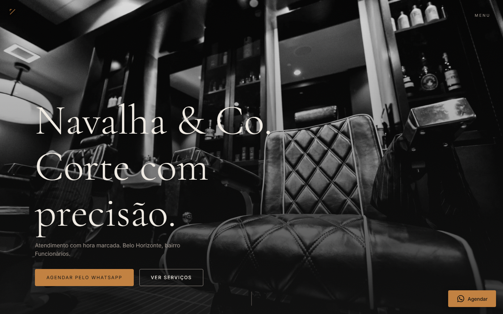

# Navalha & Co.

Site conceito de barbearia premium em Belo Horizonte, com agendamento por hora marcada.

**[▶ Ver o site ao vivo](https://kaynanfrontend.github.io/projeto-navalha/)**

## Sobre
Site conceito de uma página para uma barbearia de alto padrão no bairro Funcionários, em Belo Horizonte. O foco é passar a ideia de um espaço com personalidade e levar o visitante a agendar um horário.

Tipo: Projeto conceito

## Tecnologias
- HTML5
- CSS3
- JavaScript

## Destaques
- Layout mobile-first com pontos de quebra em 768px, 1024px e 1440px
- Animações de entrada ao rolar com `IntersectionObserver` e parallax leve no hero com `requestAnimationFrame`
- Menu de seções acessível (`aria-expanded`, foco no primeiro link) e botão de voltar ao topo
- Fonte serifada local (Cormorant Garamond), imagens com `loading="lazy"` e respeito a `prefers-reduced-motion`

---
Feito por **Kaynan Ribeiro de Sousa** · [musgoestudio.com](https://musgoestudio.com)
